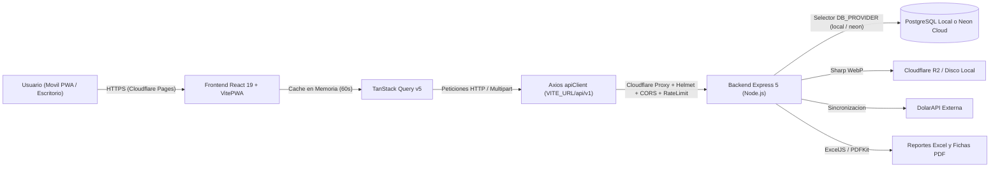
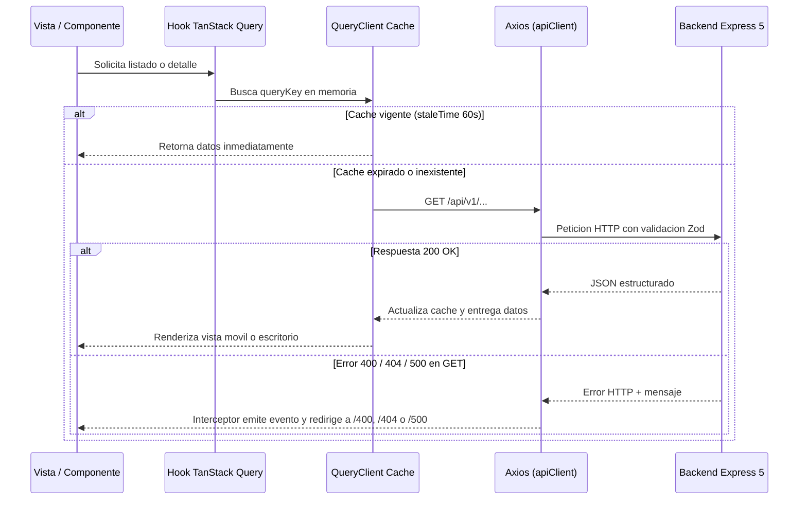
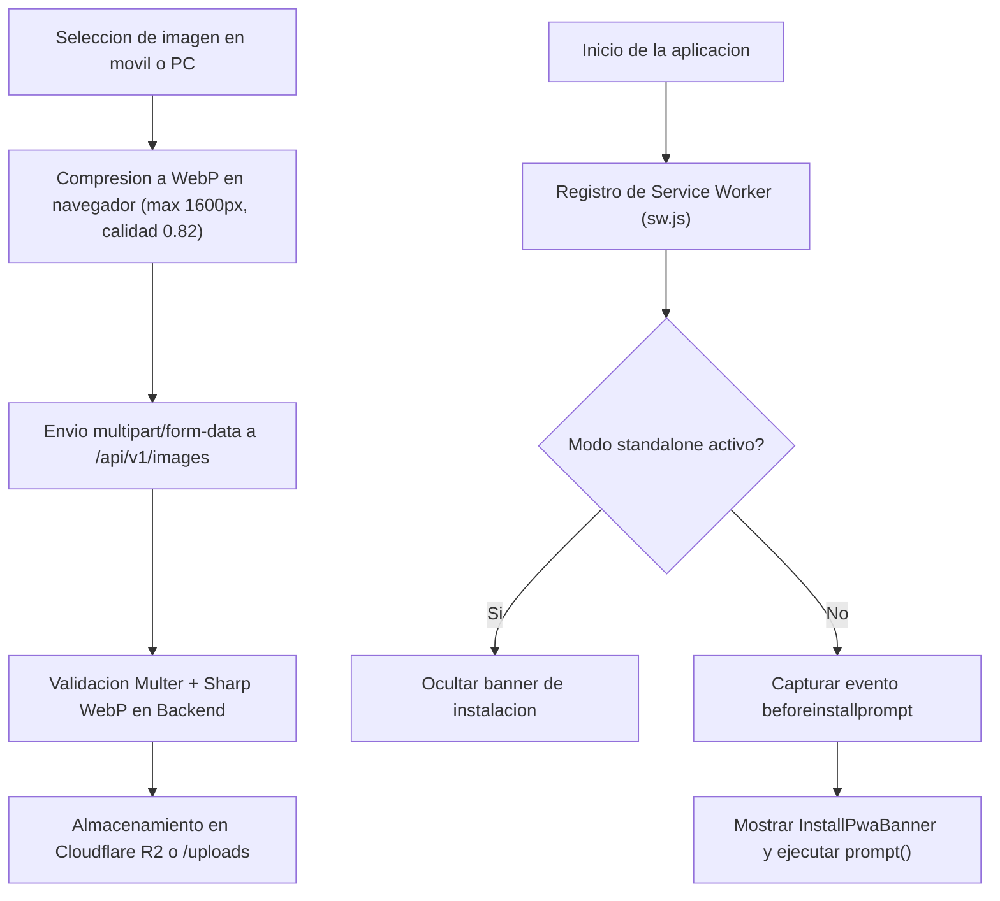

# Asoranele Gracia Divina - Plataforma de Gestion e Inventario

Plataforma web integral (**PWA Mobile-First** + **API REST**) disenada para **Asoranele Gracia Divina**, orientada a la administracion de inventario (pulseras, manualidades, viveres y articulos varios), catalogacion por categorias y unidades, control cambiario multimoneda (BCV / Paralelo), optimizacion de imagenes WebP en Cloudflare R2 y generacion de reportes comerciales en Excel y PDF.

---

## Documentacion de Modulos

- **Frontend PWA (React 19 + Vite + Tailwind CSS v4 + TanStack Query)**: [frontend/README.md](frontend/README.md)
- **Backend API (Express 5 + Prisma ORM + PostgreSQL / Neon + Cloudflare R2)**: [backend/README.md](backend/README.md)

---

## 1. Arquitectura General del Sistema

El proyecto sigue una arquitectura desacoplada Cliente-Servidor preparada para operar con **Cloudflare Pages** (frontend), **Cloudflare R2** (almacenamiento de objetos WebP), **PostgreSQL / Neon** (persistencia) y **Cloudflare Proxy / Tunnel** delante del servidor Node.js.



---

## 2. Flujo de Datos, Cache y Manejo de Errores



---

## 3. Flujo de Imagenes WebP y Ciclo PWA



---

## 4. Seguridad, Almacenamiento y Sesiones

- **Modelo sin inicio de sesion**: El panel opera como aplicacion administrativa directa sin cuentas de usuario ni tokens JWT, por lo que **no almacena cookies de sesion ni credenciales en `localStorage`**. En el navegador unicamente se utiliza `sessionStorage` para recordar si el usuario descarto temporalmente el aviso de instalacion PWA durante la sesion actual.
- **Capas de seguridad activas en el backend**:
  - **Cabeceras HTTP**: `helmet` con `crossOriginResourcePolicy: cross-origin` para carga segura de recursos multimedia.
  - **Control de origenes**: `cors` restringido a la lista blanca `ALLOWED_ORIGINS`.
  - **Proteccion contra abuso**: `express-rate-limit` dual (300 req/15 min global; 30 req/15 min en endpoints criticos de subida, importacion y sincronizacion).
  - **Validacion estricta**: Esquemas `Zod` en body, params y query, mas filtros de tipo MIME y tamano en `Multer` (5 MB por imagen, 20 MB por Excel).
  - **Proteccion SQL**: Consultas parametrizadas mediante **Prisma ORM**.
  - **Trazabilidad y Proxy**: `app.set("trust proxy", 1)` compatible con Cloudflare y asignacion de `x-request-id` UUID por peticion.

---

## 5. Inicio Rapido en Local

```bash
# 1. Instalar y configurar Backend
cd backend
cp .env.example .env
npm install
npm run db:generate
npm run db:push
npm run dev

# 2. Instalar y configurar Frontend (en otra terminal)
cd frontend
npm install
npm run dev
```

Para detalles completos de endpoints, variables de entorno, despliegue en Cloudflare y Neon, consulta [backend/README.md](backend/README.md) y [frontend/README.md](frontend/README.md).
