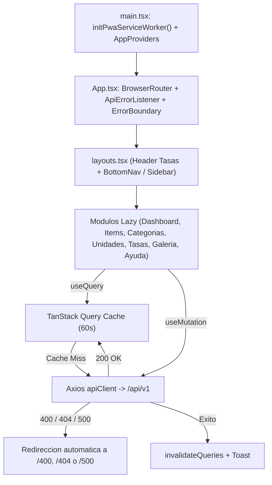

# Asoranele Gracia Divina - Frontend PWA

Panel administrativo y catalogo digital **Mobile-First** e instalable (**PWA**) para **Asoranele Gracia Divina**, disenado para la gestion de inventario (articulos, pulseras, manualidades, viveres y productos varios), categorias, unidades de medida, tasas de cambio y generacion de reportes comerciales en Excel y PDF.

Documentacion relacionada:
- **Documentacion General del Proyecto**: [../README.md](../README.md)
- **Documentacion del Backend API**: [../backend/README.md](../backend/README.md)

---

## 1. Stack Tecnologico

- **Framework UI**: React 19 + TypeScript estricto
- **Empaquetador y PWA**: Vite 7 + `vite-plugin-pwa` (Workbox `generateSW`, registro automatico y `manifest.webmanifest`)
- **Estilos**: Tailwind CSS v4 (enfoque Mobile-First y soporte `safe-area-inset`)
- **Estado Remoto y Cache**: TanStack Query v5 (`@tanstack/react-query`)
- **Cliente HTTP**: Axios (`apiClient` con sanitizacion de URL e interceptor global de errores)
- **Formularios y Validacion**: React Hook Form + Zod v4 (`@hookform/resolvers`)
- **Enrutamiento y Code Splitting**: React Router DOM v7 con `React.lazy`, `Suspense` y `ErrorBoundary`
- **Iconografia**: Lucide React

---

## 2. Estructura del Proyecto

```text
frontend/
├── public/
│   ├── _redirects                # Regla SPA fallback para Cloudflare Pages
│   ├── logo2.ico                 # Favicon oficial de Asoranele Gracia Divina
│   ├── logo.webp                 # Logotipo optimizado para interfaz y banner PWA
│   ├── flujo-usuario.webp        # Diagrama visual del manual de usuario
│   ├── apple-touch-icon.png      # Icono iOS (180x180)
│   ├── pwa-192x192.png           # Icono PWA estandar (192x192)
│   └── pwa-512x512.png           # Icono PWA maskable (512x512)
├── src/
│   ├── components/
│   │   ├── helpbutton/           # Acceso directo al manual de usuario (/ayuda)
│   │   ├── items/                # Modales de formulario WebP e importacion Excel
│   │   ├── layouts/              # Sidebar desktop, Drawer movil y BottomNav PWA
│   │   ├── pwa/                  # Banner de instalacion PWA (beforeinstallprompt)
│   │   └── ui/                   # Modal, CustomSelect, ConfirmDialog, Pagination, ErrorBoundary
│   ├── hooks/                    # Hooks TanStack Query (useItems, useCategorias, useUnidades, useTasas, useToast)
│   ├── page/
│   │   ├── dashboard/            # Panel principal y metricas
│   │   ├── item/                 # Catalogo e inventario con vistas duales
│   │   ├── categorias/           # Gestion de categorias
│   │   ├── unidades/             # Gestion de unidades de medida
│   │   ├── tasas/                # Tasas BCV/Paralelo y conversor multimoneda
│   │   ├── imagenes/             # Galeria WebP y limpieza de huerfanas
│   │   ├── help/                 # Manual interactivo del sistema
│   │   └── notfount/             # Vistas de error HTTP (400.tsx, 404.tsx, 500.tsx, ErrorLayout.tsx)
│   ├── providers/                # QueryClientProvider + ToastProvider
│   ├── pwa/                      # Registro del Service Worker (registerSW.ts)
│   ├── services/                 # Cliente Axios e interceptores (api.ts, *.service.ts)
│   ├── types/                    # Contratos TypeScript de la API
│   └── utils/                    # Formateadores y compresion WebP en navegador
├── index.html                    # Meta tags SEO, Open Graph, Twitter Card y PWA
└── vite.config.ts                # Configuracion Vite, React Compiler, Tailwind v4 y VitePWA
```

---

## 3. Funcionamiento Interno (Cache, Errores HTTP y PWA)

### Integracion Axios + TanStack Query
1. **Cliente HTTP (`src/services/api.ts`)**: `apiClient` apunta a `${VITE_URL}/api/v1` con timeout de 30 segundos y limpieza automatica de caracteres accidentales en la variable de entorno.
2. **Interceptor de Errores HTTP**: Las respuestas `GET` con codigo `400` o `404` (excepto `/tasas/latest` cuando aun no hay tasas registradas) y cualquier respuesta `500+` disparan el evento `asoranele:api-error`, que redirige mediante `ApiErrorListener` en `App.tsx` a `/400`, `/404` o `/500` conservando el detalle tecnico. Adicionalmente, `ErrorBoundary` captura excepciones de renderizado en React mostrando la vista `500`.
3. **Cache e Invalidacion**: `QueryClient` almacena las consultas en memoria durante 60 segundos (`staleTime: 60000`, `retry: 1`, `refetchOnWindowFocus: false`). Tras cualquier mutacion exitosa (`POST`, `PUT`, `PATCH`, `DELETE`), el hook correspondiente invalida las claves afectadas (`invalidateQueries`) y muestra una notificacion Toast.

### Almacenamiento Local y Privacidad
- No se utilizan `cookies` ni `localStorage` para autenticacion o seguimiento, ya que el panel es de acceso administrativo directo sin inicio de sesion.
- Unicamente `InstallPwaBanner.tsx` emplea `sessionStorage` para recordar si el usuario descarto el aviso de instalacion durante la sesion activa.

### Compresion WebP en Cliente y PWA
- `compressImageToWebp()` redimensiona imagenes a un maximo de 1600px y las convierte a `.webp` (calidad `0.82`) antes de subirlas al servidor.
- `vite-plugin-pwa` genera `manifest.webmanifest` y el Service Worker (`sw.js`), mientras que `InstallPwaBanner.tsx` escucha `beforeinstallprompt` y detecta el modo `standalone` para ocultar el banner cuando la app ya esta instalada.

---

## 4. Diagrama de Flujo del Frontend



---

## 5. Configuracion, Scripts y Despliegue en Cloudflare Pages

### Variables de Entorno (`frontend/.env`)
```env
VITE_URL=http://localhost:4000
```
En produccion, `VITE_URL` debe apuntar a la URL publica HTTPS del backend (por ejemplo `https://api.tu-dominio.com`).

### Comandos
```bash
npm install      # Instalar dependencias
npm run dev      # Desarrollo local (puerto 5173)
npm run lint     # Verificacion ESLint
npm run build    # Compilacion TypeScript + Vite + PWA (carpeta dist/)
npm run preview  # Previsualizar dist/ localmente (puerto 4173)
```

### Despliegue en Vercel o Cloudflare Pages

#### Opcion A: Vercel (recomendada si el backend tambien esta en Vercel)
1. Importa el repositorio en Vercel y configura **Root Directory** en `frontend`.
2. **Build Command**: `npm run build` · **Output Directory**: `dist`.
3. Agrega la variable de entorno `VITE_URL` con la URL HTTPS del backend desplegado en Vercel.
4. El archivo [vercel.json](vercel.json) ya incluye los `rewrites` SPA hacia `/index.html` y las cabeceras de cache para `sw.js` y `manifest.webmanifest`.

#### Opcion B: Cloudflare Pages
1. Conecta el repositorio en **Cloudflare Dashboard > Workers & Pages > Create > Pages**.
2. Configura:
   - **Root directory**: `frontend`
   - **Build command**: `npm run build`
   - **Build output directory**: `dist`
3. Agrega la variable de entorno `VITE_URL` con el dominio HTTPS de tu API backend.
4. El archivo `public/_redirects` (`/* /index.html 200`) se copia automaticamente a `dist/` para garantizar que todas las rutas SPA (`/items`, `/400`, `/404`, `/500`) funcionen al recargar el navegador.
